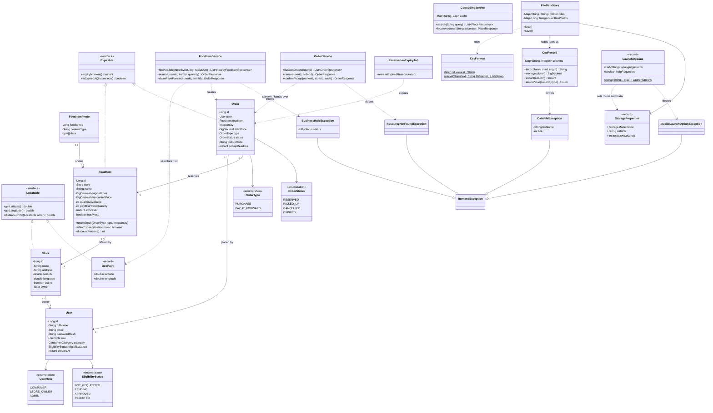

# Food Rescue: class diagram

Classes, interfaces and the relationships between them. Spring's generated repository
interfaces and the JSON request/response records are left out to keep the picture readable.
(Opens as a picture in IntelliJ's Markdown preview, on GitHub, or at https://mermaid.live.)

## Where each requirement is met

| Requirement | In the code |
|---|---|
| ≥ 4 classes | `User`, `Store`, `FoodItem`, `Order`, `FoodItemPhoto`, `GeoPoint`, the services, `FileDataStore`, ... |
| ≥ 2 interfaces | `Locatable` (`Store`, `GeoPoint`), `Expirable` (`FoodItem`, `Order`) |
| ≥ 2 collections | `GeocodingService.cache` (`LinkedHashMap` of `List`), `FileDataStore.writtenFiles` / `writtenPhotos` (`HashMap`), the `HashSet`s of known ids in `FileDataStore.load()`, `LaunchOptions.springArguments` (`List`) |
| Files | `FileDataStore` writes `data/*.csv` + `data/photos/` and reads them back at startup |
| Config / arguments | `application.yml`, `application-files.yml`, `application-postgres.yml`; `--mode=demo/files`, `--data-dir=`, `--port=` (`LaunchOptions`) |
| Java exceptions handled | `IOException`, `NoSuchFileException`, `MalformedInputException`, `AtomicMoveNotSupportedException`, `InvalidPathException` (`FileDataStore`, `LaunchOptions`); `NumberFormatException`, `DateTimeParseException`, `IllegalArgumentException` (`CsvRecord`, `LaunchOptions`); `InterruptedException` (`GeocodingService`) |
| Custom exceptions | `BusinessRuleException`, `ResourceNotFoundException`, `DataFileException`, `InvalidLaunchOptionException` |
| Input validation | Bean Validation on every request body (`dto/*Request`) and query parameter; settings checked at startup (`@Validated` on `FoodRescueProperties`, `StorageProperties`); program arguments (`LaunchOptions`); every value read from a file (`CsvRecord`, `FileDataStore`) |
