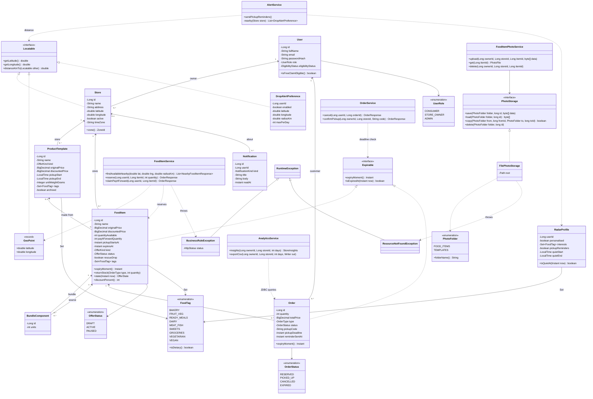

# Food Rescue: class diagram

The application's own classes, interfaces and the relationships between them. Spring's generated
repository interfaces, the JSON request/response records and configuration classes are left out
so the picture stays readable. (Opens as a picture in IntelliJ's Markdown preview, on GitHub, or
when pasted into https://mermaid.live, which can also export it as PNG or SVG.)

## Reading guide

| Arrow | Meaning | Example |
|---|---|---|
| `<\|..` dashed, hollow head | implements an interface | `Store` implements `Locatable` |
| `<\|--` solid, hollow head | extends a class | `BusinessRuleException` extends `RuntimeException` |
| `<--` with numbers | association (a field), with multiplicity | many `Order`s point to one `FoodItem` |
| `-->` | has a field of that type | `Order` has an `OrderStatus` |
| `..>` dashed | uses / depends on | `FoodItemService` creates a `GeoPoint` to measure distances |

**Interfaces (3, all specific to this app):** `Locatable`, `Expirable`, `PhotoStorage`.

**Collections:** `Set<FoodTag>` (an `EnumSet`) in `FoodItem`, `ProductTemplate` and `RadarProfile`;
`List<...>` results from the services; the address cache `Map<String, List<PlaceResponse>>` in
`GeocodingService`.
